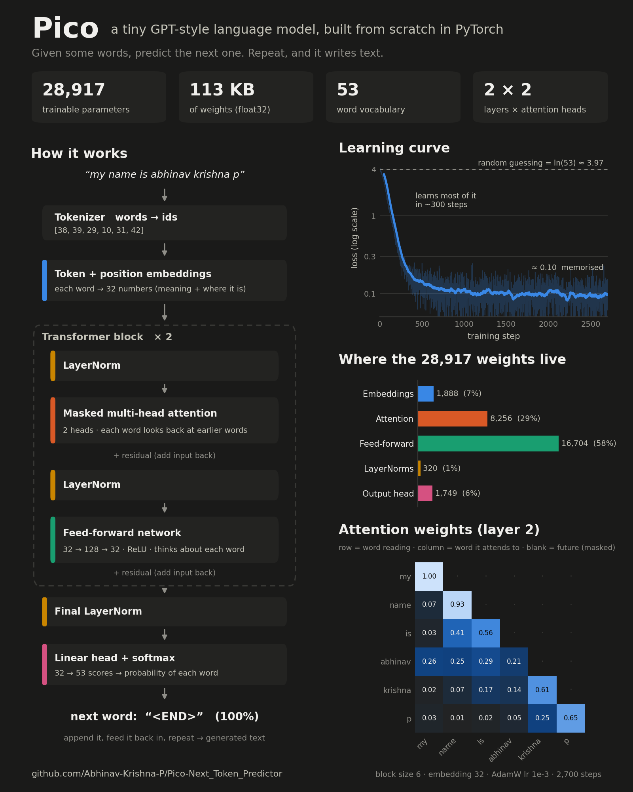

<p align="center"><picture><source media="(prefers-color-scheme: dark)" srcset="assets/logo_dark.svg"></picture></p>

# Pico – Next Token Predictor

Pico is a tiny GPT-style language model built from scratch in PyTorch, made for learning how LLMs work.

Give it some text, and it predicts the next token. Repeat that, and it writes text. Fine-tuned on
grammar pairs, it corrects grammatical mistakes:

```
python correct.py "He dont like coffee."      ->  He doesn't like coffee.
python correct.py "I has a apple."            ->  I have an apple.
python correct.py "She go to school yesterday." -> She went to school yesterday.
```



## Project structure

```
Pico/
├── correct.py              # fix grammar with a trained model (start here)
├── pico/                   # the model
│   ├── model.py            #   Pico GPT: embeddings, transformer blocks, generation, resizing
│   └── transformer_block.py#   causal self-attention, feed-forward, transformer block
├── training/               # everything used to train models
│   ├── train_small.py      #   small CPU pre-training on TinyStories (models/pico.pt)
│   ├── prepare_data.py     #   download + tokenize the large GPU dataset (data/big/)
│   ├── pretrain.py         #   large GPU pre-training (models/pico_big.pt)
│   ├── make_synthetic.py   #   synthetic grammar pairs with common learner mistakes
│   ├── finetune_grammar.py #   grammar-correction fine-tuning
│   └── export_model.py     #   strip the optimizer state -> ~3x smaller file for inference
├── evaluation/
│   ├── evaluate.py         #   test a grammar model and write a one-page HTML report
│   └── reports/            #   report.html + report.json
├── model  testing/         # 30 test sentences (qns.txt) + answer key (ans.txt)
├── notebooks/
│   ├── pico_kaggle.ipynb   # large pre-training + fine-tuning on a free Kaggle GPU
│   └── pico_colab.ipynb    # the same on Google Colab
├── data/
│   ├── corpus.txt          # your own sentences
│   ├── words_alpha.txt     # ~370k English words (tokenizer vocabulary)
│   └── ...                 # downloaded / generated data (stories.txt, train.jsonl, big/), not in git
├── models/                 # checkpoints + tokenizers
│   ├── pico.pt, tokenizer.model                                  # small pre-trained model
│   ├── pico_grammar.pt, tokenizer_grammar.model                  # small grammar model
│   └── pico_big_grammar_small.pt, pico_big_grammar_tokenizer.model  # large grammar model (from Kaggle)
├── assets/               # logo (logo.svg, logo_dark.svg, logo_mark.svg/png), poster and overview image
└── requirements.txt
```

All commands are run from the project root. Training scripts are run as modules (`python -m training.<name>`).

## Setup

```bash
python -m venv .venv
.venv\Scripts\activate          # Windows  (Linux/macOS: source .venv/bin/activate)
pip install -r requirements.txt
```

## Correct grammar

```bash
python correct.py "they was playing in park"     # correct one sentence
python correct.py                                # interactive mode (empty line to quit)
python correct.py --model models/pico_grammar.pt "..."   # use the small laptop-trained model
```

The default model is `models/pico_big_grammar_small.pt` (~34M parameters, trained on Kaggle). Its tokenizer
`pico_big_grammar_tokenizer.model` must be in the same folder. These files are too big for git: download
them from the Kaggle notebook's **Output** tab into `models/`.

## Evaluate the model

```bash
python -m evaluation.evaluate                                  # big model vs the small baseline
python -m evaluation.evaluate --model models/pico_grammar.pt --baseline none
```

Runs every sentence in `model  testing/qns.txt` through the model, compares it with `ans.txt` and writes
`evaluation/reports/report.html`: parameters, tokens, latency, loss / perplexity, exact match, word errors
before vs after, and edit precision / recall / F0.5, with a per-sentence breakdown.

Current results (30 sentences, laptop CPU):

| | Large model (33.9M) | Small model (3.3M) |
|---|---|---|
| Sentences fixed exactly | **11/30** | 1/30 |
| Word errors removed | **26%** | −31% (made it worse) |
| Edit F0.5 | **0.57** | 0.10 |
| Test loss on answer key | **0.49** | 1.34 |
| Median latency (varies per run) | ~0.5–0.6 s | **~0.1 s** |

## Small model on a CPU

| | CPU | GPU |
|---|---|---|
| Parameters | ~3.3M | ~13.8M |
| Vocabulary | 8,000 | 8,000 |
| Context length | 64 tokens | 256 tokens |
| Layers / heads | 4 / 6 | 6 / 6 |
| Embedding size | 192 | 384 |
| Batch / steps | 32 / 3000 | 64 / 5000 |

- Data: `data/stories.txt` – [TinyStories](https://huggingface.co/datasets/roneneldan/TinyStories) (~27k short stories), downloaded automatically, plus `data/corpus.txt`
- Tokenizer: SentencePiece BPE with an 8,000-token vocabulary, trained on the stories and `data/words_alpha.txt`
- Training: AdamW with weight decay, linear warmup + cosine LR decay, gradient clipping, dropout, weight tying, fused attention (`scaled_dot_product_attention`); the best checkpoint by validation loss is saved

```bash
python -m training.train_small                        # trains once and saves models/pico.pt, then just generates
python -m training.train_small --prompt "The little dog"
python -m training.train_small --resume --steps 2000  # continue training
python -m training.train_small --retrain              # train again from scratch
python -m training.train_small --retrain-tokenizer --retrain   # rebuild the tokenizer too
```

## Large pre-training on a GPU (Kaggle / Colab)

| | |
|---|---|
| Data | full TinyStories (~2.1M stories) + 300k FineWeb-Edu documents ≈ 780M tokens |
| Tokenizer | 16k SentencePiece BPE with byte fallback (no unknown characters) |
| Model | ~34M parameters, 8 layers / 8 heads, 512 embedding, 512-token context |
| Training | 600M tokens, mixed precision, gradient accumulation, checkpoints every 10 min, auto-resume |

**Kaggle (recommended):** import `notebooks/pico_kaggle.ipynb` (**Create → New Notebook → File → Import Notebook**),
enable **GPU T4 x2** and **Internet**, add your `train.jsonl` as an input dataset, then
**Save Version → Save & Run All**. It runs in the background for up to 12 hours (30 GPU hours/week free),
stops itself safely before the limit, and can continue from its own previous output. To only redo the grammar
fine-tuning, add the finished run's output as input (**Add Input → Your Work → Notebooks**) and run again:
data preparation and pre-training are skipped (~25 min).

**Colab:** open `notebooks/pico_colab.ipynb` in Colab, pick a **T4 GPU** runtime and run the cells in order.
Data and checkpoints are saved to Google Drive (`MyDrive/pico/`).

The scripts can also be run directly:

```bash
python -m training.prepare_data                       # download + tokenize into data/big (once)
python -m training.pretrain                           # pre-train models/pico_big.pt (re-run to resume)
python -m training.make_synthetic --out data/synthetic.jsonl
python -m training.finetune_grammar --data data/train.jsonl data/synthetic.jsonl --base models/pico_big.pt \
    --out models/pico_big_grammar.pt --tokenizer-out models/pico_big_grammar_tokenizer.model --steps 15000 --batch-size 32
python -m training.export_model models/pico_big_grammar.pt models/pico_big_grammar_small.pt
```

## Grammar fine-tuning

Each `{"input": wrong, "output": corrected}` pair is trained as `Incorrect: <input> Correct: <output></s>`,
with the loss only on the corrected part.

- `data/train.jsonl` – 100k pairs, mostly long Wikipedia-style sentences
- `make_synthetic.py` – ~400k short sentences from TinyStories + FineWeb-Edu, broken on purpose with common
  learner mistakes: a/an, missing articles, *dont*, was/were and has/have, *he go* / *they plays*, wrong tense,
  *I am work*, to/too and their/there, prepositions, plurals, capitals and punctuation (10% are left correct, so the
  model learns to leave good sentences alone)
- Symbols the base tokenizer never saw are appended to the vocabulary, so all pre-trained token ids stay valid

```bash
python -m training.finetune_grammar                   # small model: models/pico.pt -> models/pico_grammar.pt
python -m training.finetune_grammar --resume --steps 3000
```
