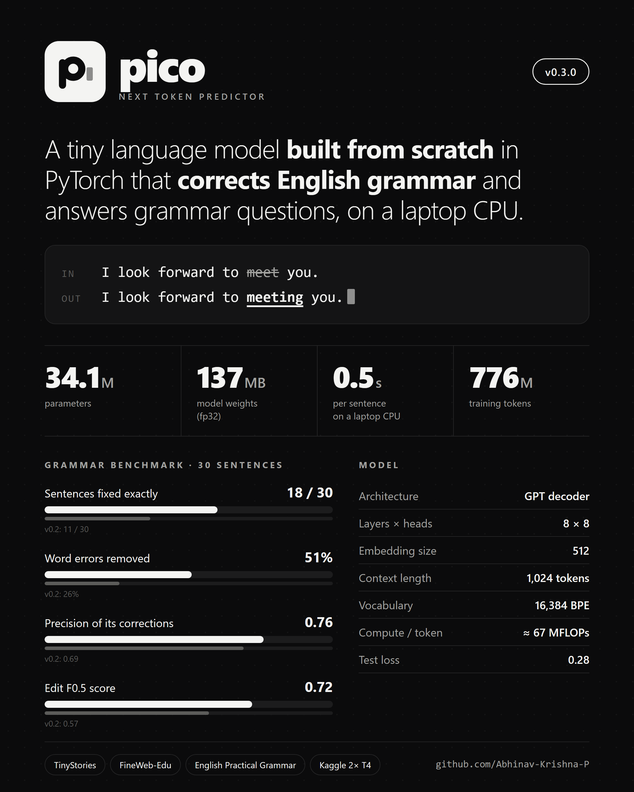

<p align="center"><picture><source media="(prefers-color-scheme: dark)" srcset="assets/logo_dark.svg"></picture></p>

# Pico – Next Token Predictor

Pico is a tiny GPT-style language model built from scratch in PyTorch, made for learning how LLMs work.
It predicts the next token; repeat that and it writes text. Fine-tuned on grammar data, **Pico v0.3.0
corrects English grammar and answers grammar questions**, running on a laptop CPU:

```
python correct.py "She bought a new furnitures for her room."   ->  She bought a new furniture for her room.
python correct.py "I look forward to meet you."                 ->  I look forward to meeting you.
python correct.py "Despite of the rain, we went out."           ->  Despite the rain, we went out.
python ask.py "What is a noun?"                                 ->  A noun is a naming word. It refers to a person, a place or a thing. …
```

<p align="center"></p>

## Pico v0.3.0 at a glance

| | |
|---|---|
| Parameters | **34,120,704** (34.1M) – 8.9M embeddings (tied with the output) + 25.2M transformer |
| Weights | **137 MB** (float32) |
| Architecture | GPT decoder · 8 layers × 8 heads · 512 embedding · 1,024-token context · ≈ 67 MFLOPs per token |
| Tokenizer | SentencePiece BPE, **16,384** tokens, byte fallback |
| Pre-training | **776M tokens** (TinyStories + FineWeb-Edu), 600M trained · 4,577 steps · val loss 2.50 · Kaggle 2× T4, ~4 h |
| Fine-tuning | 100k grammar pairs + 388k synthetic learner mistakes + the [English Practical Grammar dataset](https://github.com/Abhinav-Krishna-P/English-practical-grammer-Dataset) (4,233 conversations + 653 extracted pairs) · 20,000 steps · val loss 0.92 |
| Benchmark (30 sentences) | **18/30** fixed exactly · **51%** of word errors removed · precision **0.76** · F0.5 **0.72** · test loss **0.28** |
| Speed | ~0.5 s per sentence on a laptop CPU |

### Versions

| | v0.1.0 | v0.2.0 | v0.3.0 |
|---|---|---|---|
| Parameters | 28,917 | 33.9M | **34.1M** |
| Vocabulary | 53 words | 16,384 BPE | 16,384 BPE |
| Layers × heads | 2 × 2 | 8 × 8 | 8 × 8 |
| Training data | 9 sentences | 776M tokens + 485k grammar pairs | + English Practical Grammar dataset |
| Benchmark | – | 11/30 | **18/30** |
| What it does | memorises its corpus | corrects grammar | corrects grammar + **answers grammar questions** |

The v0.1.0 overview is kept in [assets/pico_overview.png](assets/pico_overview.png).

## Project structure

```
Pico/
├── correct.py                  # fix grammar (start here)
├── ask.py                      # ask a grammar question
├── pico/                       # the model
│   ├── model.py                #   Pico GPT: embeddings, transformer blocks, generation, resizing
│   ├── transformer_block.py    #   causal self-attention, feed-forward, transformer block
│   └── grammar.py              #   load a model, correct sentences, answer questions
├── models/                     # the trained model (not in git, see below)
│   ├── pico_big_grammar_small.pt
│   └── pico_big_grammar_tokenizer.model
├── evaluation/
│   ├── evaluate.py             #   benchmark a model and write a one-page HTML report
│   ├── test_set/               #   30 test sentences (qns.txt) + answer key (ans.txt)
│   └── reports/                #   report.html + report.json
├── training/                   # everything used to train the model
│   ├── prepare_data.py         #   download + tokenize the pre-training data (data/big/)
│   ├── pretrain.py             #   pre-training on a GPU
│   ├── make_synthetic.py       #   synthetic grammar pairs with common learner mistakes
│   ├── extract_grammar_pairs.py#   correction pairs from the English Practical Grammar dataset
│   ├── finetune_grammar.py     #   grammar fine-tuning (correction pairs + Question/Answer conversations)
│   ├── export_model.py         #   strip the optimizer state -> ~3x smaller file for inference
│   └── train_small.py          #   small CPU-only model (for learning, v0.1-style)
├── notebooks/
│   └── pico_kaggle.ipynb       # the full training run on a free Kaggle GPU
├── data/
│   ├── train.jsonl             # 100k grammar pairs (not in git)
│   ├── grammar_book.jsonl      # pairs extracted from the grammar dataset (not in git)
│   ├── corpus.txt, words_alpha.txt   # used by train_small.py / the tokenizer
├── assets/                     # logo, poster, v0.1.0 overview
└── requirements.txt
```

All commands are run from the project root. Training scripts are run as modules (`python -m training.<name>`).

## Setup

```bash
python -m venv .venv
.venv\Scripts\activate          # Windows  (Linux/macOS: source .venv/bin/activate)
pip install -r requirements.txt
```

The model files are too big for git: download `pico_big_grammar_small.pt` and `pico_big_grammar_tokenizer.model`
from the Kaggle notebook's **Output** tab into `models/`.

## Use

```bash
python correct.py "they was playing in park"     # correct one sentence
python correct.py                                # interactive mode (empty line to quit)
python ask.py "What is a noun?"                  # grammar question (experimental, see below)
python ask.py                                    # interactive mode
```

`ask.py` is **experimental**: answers are good for questions close to the English Practical Grammar dataset
(*What is a noun?*), but for other questions a 34M-parameter model often repeats itself or makes things up.
Sentence correction (`correct.py`) is the reliable feature.

## Evaluate

```bash
python -m evaluation.evaluate                                    # writes evaluation/reports/report.html
python -m evaluation.evaluate --baseline models/other_model.pt   # compare two models
```

Runs every sentence in `evaluation/test_set/qns.txt` through the model, compares it with `ans.txt` and reports
parameters, tokens, latency, loss / perplexity, exact match, word errors before vs after and edit precision /
recall / F0.5, with a per-sentence breakdown.

| | v0.3.0 | v0.2.0 |
|---|---|---|
| Sentences fixed exactly | **18/30** | 11/30 |
| Fixed, on the 19 sentences **not** in the training data | **9/19** | 8/19 |
| Word errors removed | **51%** | 26% |
| Edit precision / F0.5 | **0.76 / 0.72** | 0.69 / 0.57 |
| Test loss on the answer key | **0.28** | 0.49 |
| Median latency (laptop CPU) | ~0.5 s | ~0.5 s |

11 of the 30 test sentences (or close variants) also appear in the English Practical Grammar dataset. They are
marked in the report (`data/grammar_book_test_overlap.json`), and the score on the 19 unseen sentences is the
fair comparison.

## Training

Everything runs in `notebooks/pico_kaggle.ipynb` on a free Kaggle GPU: import it (**Create → New Notebook → File →
Import Notebook**), enable **GPU T4 x2** and **Internet**, add `train.jsonl` as an input dataset, then **Save Version →
Save & Run All**. It runs in the background for up to 12 hours, stops itself safely before the limit and continues
from its own previous output. Once pre-training is done, adding that output as input (**Add Input → Your Work →
Notebooks**) re-runs only the grammar fine-tuning (~1 hour).

**1. Pre-training** – full TinyStories (2.1M stories, 452M tokens) + 300k FineWeb-Edu documents (328M tokens);
16k SentencePiece BPE tokenizer with byte fallback; 600M training tokens with mixed precision, gradient accumulation,
AdamW, warmup + cosine decay and checkpoints every 10 minutes.

**2. Grammar fine-tuning** – each example is trained with the loss only on the answer part:

- `Incorrect: <wrong sentence> Correct: <corrected sentence></s>` for
  - `data/train.jsonl` – 100k pairs, mostly long Wikipedia-style sentences
  - `make_synthetic.py` – ~388k short sentences broken on purpose with common learner mistakes (a/an, missing
    articles, *dont*, was/were, *he go*, wrong tense, *I am work*, prepositions, plurals, punctuation …)
  - `extract_grammar_pairs.py` – 653 pairs from the dataset's exercises (corrections, prepositions, articles,
    tenses, verb choice, punctuation), repeated x20
- `Question: <question> Answer: <answer></s>` for **all 4,233 conversations** of the English Practical Grammar
  dataset (21 chapters), repeated x10

```bash
python -m training.prepare_data                       # download + tokenize into data/big (once)
python -m training.pretrain                           # pre-train models/pico_big.pt (re-run to resume)
python -m training.make_synthetic --out data/synthetic.jsonl
git clone https://github.com/Abhinav-Krishna-P/English-practical-grammer-Dataset data/english-practical-grammar
python -m training.extract_grammar_pairs              # -> data/grammar_book.jsonl + test-set overlap
python -m training.finetune_grammar --data data/train.jsonl data/synthetic.jsonl "data/grammar_book.jsonl*20" \
    $(for f in data/english-practical-grammar/data/*.jsonl; do echo "$f*10"; done) \
    --block-size 1024 --steps 20000 --batch-size 32  # -> models/pico_big_grammar.pt
python -m training.export_model models/pico_big_grammar.pt models/pico_big_grammar_small.pt
```

`python -m training.train_small` trains a small 3.3M-parameter model on TinyStories on a CPU only, for learning
how pre-training works.
